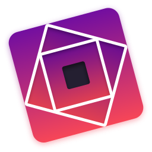

<p align="center">
  
</p>

<h1 align="center">
 Quadra, by QuadraHQ.
</h1>

 <p align="center">
    <a href="https://discord.gg/W8jXfngc8z">
      
   </a>
 </p>

<p align="center">
  A bootstrapper for the macOS Roblox Player & Studio client, running on Linux through <a href="https://github.com/microlift/rosemary">Rosemary</a>.
</p>

## Install

```
curl -fsSL https://quadrahq.org/install.sh | bash
```

This installs the newest Quadra as an AppImage in `~/.local/bin` and adds it to the app menu. Run it again to update.
Options go after `bash -s --`, for example `curl -fsSL https://quadrahq.org/install.sh | bash -s -- --flatpak`:

- `--flatpak`: install the Flatpak bundle instead
- `--native`: build Quadra on this computer instead
- `--tarball`: same as native, but with pre-compiled binaries
- `--version TAG`: install a specific release, such as `v0.50.0-alpha.3`
- `--uninstall`: remove Quadra but keep its data and your Roblox sign-in; add `--purge` to delete those too

The installer checks every download against the release's `SHA256SUMS` before installing it.

## Build instructions

**Prerequisites:**

- Git
- Rust 1.92+
- A C compiler (Quadra's GUI, iced, loads Wayland/X11, xkbcommon and the GPU driver at runtime, so no GUI headers are needed)
- clang for VR support (optional; without it Quadra builds without VR)
- flatpak-builder for building Flatpaks
- curl for building AppImages

**Fetch source:**

```
git clone https://github.com/QuadraHQ/quadra && cd quadra
```

**Build directly from source:**

```
cargo build
```

**Build Flatpak:**

```
cd flatpak && flatpak-builder --force-clean --user --install-deps-from=flathub --repo=repo --install build-dir org.quadrahq.Quadra.yml
```

**Build AppImage:**

```
./appimage/build.sh
```

The AppImage is written to `appimage/Quadra-x86_64.AppImage`.

**Nix:**

Try it without installing:

```sh
nix run github:QuadraHQ/quadra
```

Flake input:

```Nix
{
  inputs = {
    nixpkgs.url = "github:NixOS/nixpkgs/nixos-unstable";
    quadra.url = "github:QuadraHQ/quadra";
  };
}
```

```Nix
{
  environment.systemPackages = with pkgs; [
    inputs.quadra.packages.${pkgs.stdenv.hostPlatform.system}.quadra
  ];
}
```

## Relevant directories

- `~/.local/share/quadra`: Where Quadra stores its data
- `~/.local/share/quadra/prefix`: The Rosemary prefix Roblox runs in
- `~/.local/share/quadra/rosemary/<version>`: Installed Rosemary versions
- `~/.local/share/quadra/roblox`: The Roblox Player installation
- `~/.local/share/quadra/logs`: Quadra and Roblox logs
- `~/.local/share/quadra/modifications`: Your own files that Quadra overlays onto the Roblox client (see the Mods settings)
- `~/.local/share/quadra/mods-backup`: The original Roblox files that mods replaced, so they can be put back
- `~/.cache/quadra/downloads`: Downloaded files, such as Rosemary and Roblox packages
- `~/.cache/quadra/vr`: The VR library Rosemary loads into Roblox
- `~/.config/quadra/themes`: Themes you imported from CSS files
- `~/.config/quadra/fonts`: Fonts you imported for Quadra's own text
- `~/.local/share/butter/runners` and `~/.var/app/io.github.microlift.butter/data/butter/runners`: Butter runner directories that Quadra also detects runners from

## Background picture

Settings › General › Appearance › Background picture shows a PNG, JPEG or WebP picture behind Quadra instead of the theme's background. The chosen background animation plays over it, adding only its light, such as rain, petals or snow. Picture dimming shades the picture in the theme's window colour so text stays readable.

## Font, text size and accent colour

Settings › General › Appearance › Font changes the font of Quadra's own text, whatever the theme. It offers Quadra's built-in fonts, the preset game fonts and any `.ttf` or `.otf` font you import; each one is shown in its own typeface. Text size makes Quadra's text from 80% to 150% of its usual size. Accent colour replaces the theme's accent with any colour you type.

## Custom themes

The Import CSS theme card in Settings › General › Appearance imports a theme from a CSS file. Quadra only reads custom properties, so a theme sets colours and a few other values, not selectors or layout:

```css
:root {
  --name: "Midnight";
  --window: #0d1520;
  --card: rgba(255, 255, 255, 0.05);
  --text: #e6edf3;
  --accent: #58a6ff;
  --radius: 12px;
  --font: "Inter";
  --background: linear-gradient(180deg, #0d1520, #10263d);
  --animation: waves;
  --animation-colors: #1d4f91, #2389c9, #7fd3f0;
}
```

- Colours: `--window`, `--card`, `--text`, `--dimmed`, `--accent`, `--on-accent`, `--accent-text`, `--border`, `--strong-border`, `--raised`, `--hovered`, `--pressed`, `--field`, `--dialog`, `--shade`, `--title-bar`, `--destructive`, `--success`, `--warning`. Use `#rgb`, `#rrggbb`, `#rrggbbaa`, `rgb()` or `rgba()`.
- `--radius` in pixels, `--font` and `--mono-font` as the name of an installed font, and `--name` for the name shown in Settings (the file name otherwise).
- `--background`: a colour or a `linear-gradient(…)` with up to 8 colours. It shows when the theme has no animation.
- `--animation`: `aurora`, `embers`, `leaves`, `scanlines`, `waves`, `fireflies`, `bokeh`, `warp`, `rain`, `lava`, `silk`, `snow`, `petals`, `horizon`, `lines`, `facets` or `none`, with up to three `--animation-colors`. Most of them add light, so they look best on dark themes.

Anything left out comes from Adwaita's light or dark look, picked by how bright `--window` is. Values Quadra can't read are skipped and named in the log. The animation and its colours can also be changed for any theme under Background animation.

## Fonts

The preset fonts for the game's text are under the SIL Open Font License; each one's licence sits next to it in `data/mods/fonts/`.

## License

GPL-3.0-only.
