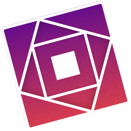

<p align="center">
  
</p>

<h1 align="center">
 Quadra, by QuadraHQ.
</h1>

 <p align="center">
    <a href="https://discord.gg/W8jXfngc8z">
      
   </a>
 </p>

<p align="center">
  A bootstrapper for the macOS Roblox Player & Studio client, running on Linux through <a href="https://github.com/microlift/rosemary">Rosemary</a>.
</p>

## EXPERIMENTAL WARNING

This is a rewrite of Quadra in Rust. This hasn't been extensively tested yet, and there are some missing features, including:

- Auto-updater for Flatpak (the AppImage updates itself)
- Support for the Darling runtime

## Build instructions

**Prerequisites:**

- Git
- rustup
- GTK4 and libadwaita
- clang for VR support (optional; without it Quadra builds without VR)
- flatpak-builder for building Flatpaks
- curl for building AppImages

**Fetch source:**

```
git clone https://github.com/QuadraHQ/quadra-rewrite && cd quadra-rewrite
```

**Build directly from source:**

```
cargo build
```

**Build Flatpak:**

```
cd flatpak && flatpak-builder --force-clean --user --install-deps-from=flathub --repo=repo --install build-dir org.quadrahq.Quadra.yml
```

**Build AppImage:**

```
./appimage/build.sh
```

The AppImage is written to `appimage/Quadra-x86_64.AppImage`.

## Relevant directories

- `~/.local/share/quadra`: Where Quadra stores its data
- `~/.local/share/quadra/prefix`: The Rosemary prefix Roblox runs in
- `~/.local/share/quadra/rosemary/<version>`: Installed Rosemary versions
- `~/.local/share/quadra/roblox`: The Roblox Player installation
- `~/.local/share/quadra/logs`: Quadra and Roblox logs
- `~/.local/share/quadra/modifications`: Your own files that Quadra overlays onto the Roblox client (see the Mods settings)
- `~/.local/share/quadra/mods-backup`: The original Roblox files that mods replaced, so they can be put back
- `~/.cache/quadra/downloads`: Downloaded files, such as Rosemary and Roblox packages
- `~/.cache/quadra/vr`: The VR library Rosemary loads into Roblox
- `~/.local/share/butter/runners` and `~/.var/app/io.github.microlift.butter/data/butter/runners`: Butter runner directories that Quadra also detects runners from

## License

GPL-3.0-only.

## Credits

- [Fishstrap](https://github.com/fishstrap/fishstrap) (MIT, by returnrqt) for the overlay's design, and [Bloxstrap](https://github.com/bloxstraplabs/bloxstrap) (MIT, by pizzaboxer) which Fishstrap is built on. Their license texts are in [THIRD_PARTY_NOTICES.md](THIRD_PARTY_NOTICES.md).
